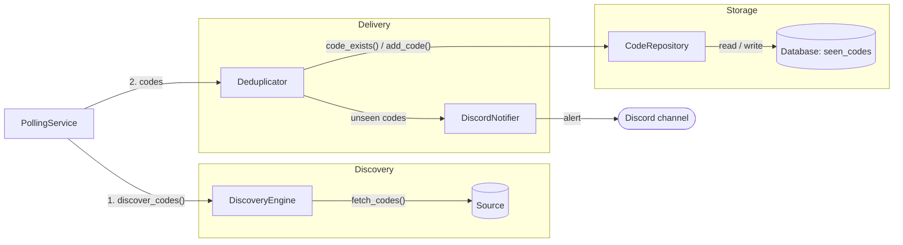
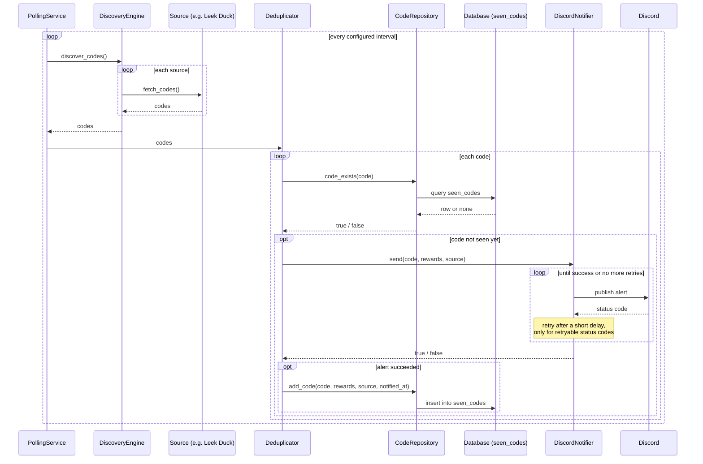

# Architecture

This document describes how PoGO Pings is put together and how a single poll flows through its components. For setup and usage, see the README.

## The Poll Cycle

On every interval, `PollingService` runs one poll:

1. **Discover:** it calls `DiscoveryEngine.discover_codes()`, which iterates through every configured source and calls its `fetch_codes()`. Leek Duck is currently the only source.
2. **Deduplicate and notify:** it passes the discovered codes to the `Deduplicator`. For any code that hasn't been seen yet, the `Deduplicator` (which checks the `seen_codes` table in the database through the `CodeRepository`) calls `DiscordNotifier` to publish it to Discord. Depending on the response status code, `DiscordNotifier` may retry the alert within the same poll, after a short delay. If the alert succeeds, the code is inserted into `seen_codes`.

## Components

| Component | Responsibility |
| --- | --- |
| **PollingService** | Runs the poll loop at the configured interval. |
| **DiscoveryEngine** | Collects codes from all sources. |
| **Sources** | Fetch codes from one place each (currently Leek Duck). |
| **Deduplicator** | Filters out codes already recorded in `seen_codes` |
| **DiscordNotifier** | Sends alerts to Discord, with retries. |
| **CodeRepository** | Provides functions for interacting with the database, such as reading and writing `seen_codes`. |
| **seen_codes** | Database table of codes already sent. |

## Design Notes

- **Codes are marked as seen only after a successful alert.** Some failures are retried within the same poll, after a short delay, depending on the response status code. If Discord is still unreachable, the code stays unseen and is retried on the next poll instead of being silently lost.
- **Sources are pluggable.** `DiscoveryEngine` just iterates over its sources and calls `fetch_codes()`, so adding a new source doesn't require changes to the rest of the pipeline. Sources should follow the `PromoCodeSource` interface.
- **Isolated concerns:** discovery, deduplication, and notification are separate components, which keeps each one easy to test (see `tests/`).
